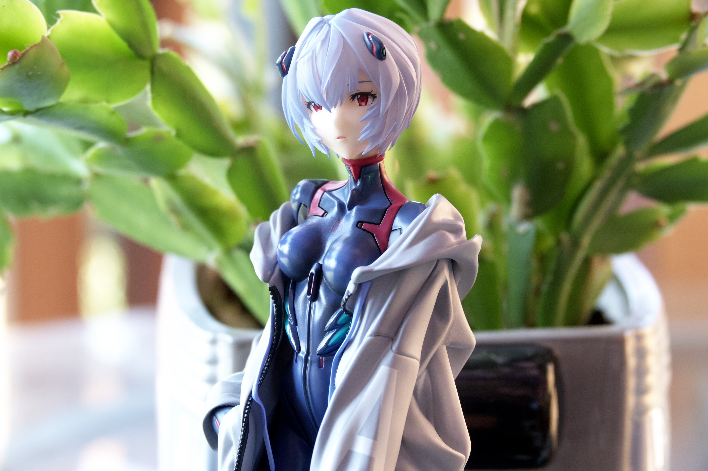
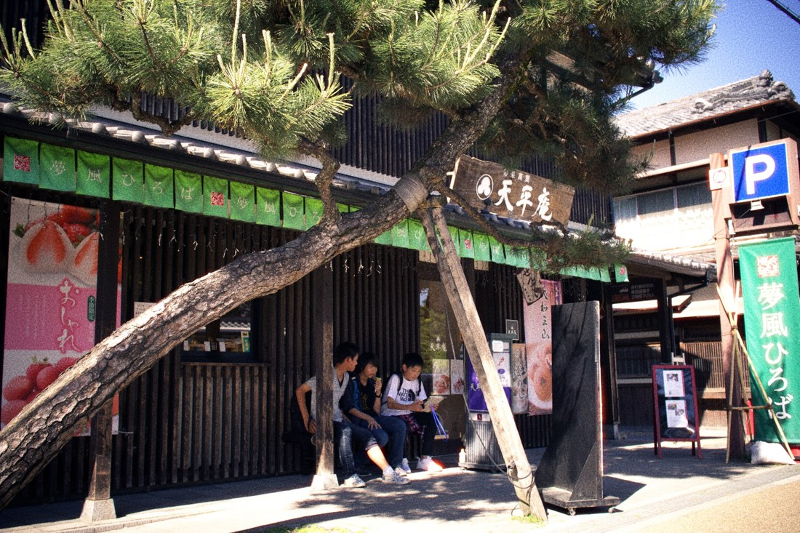
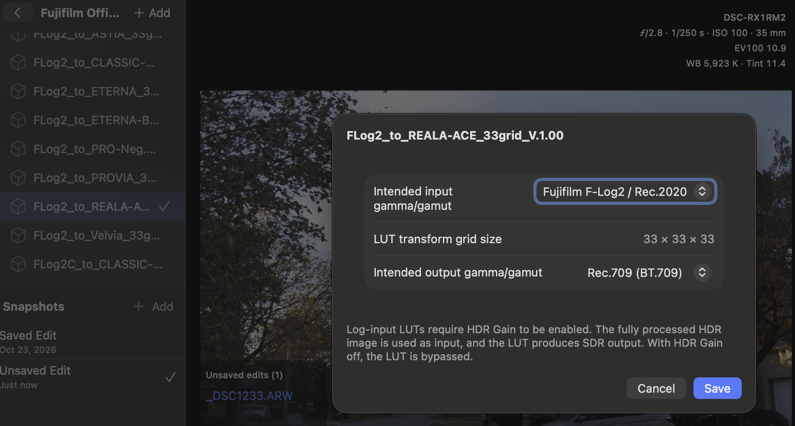
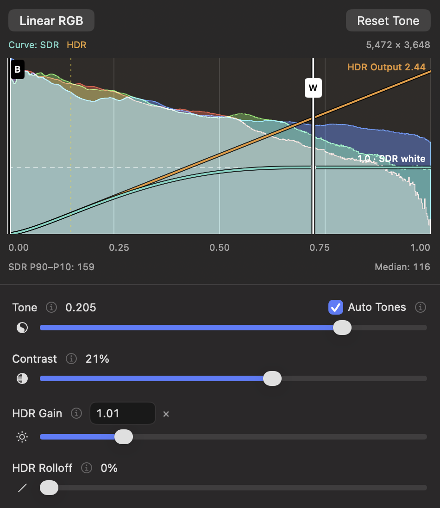
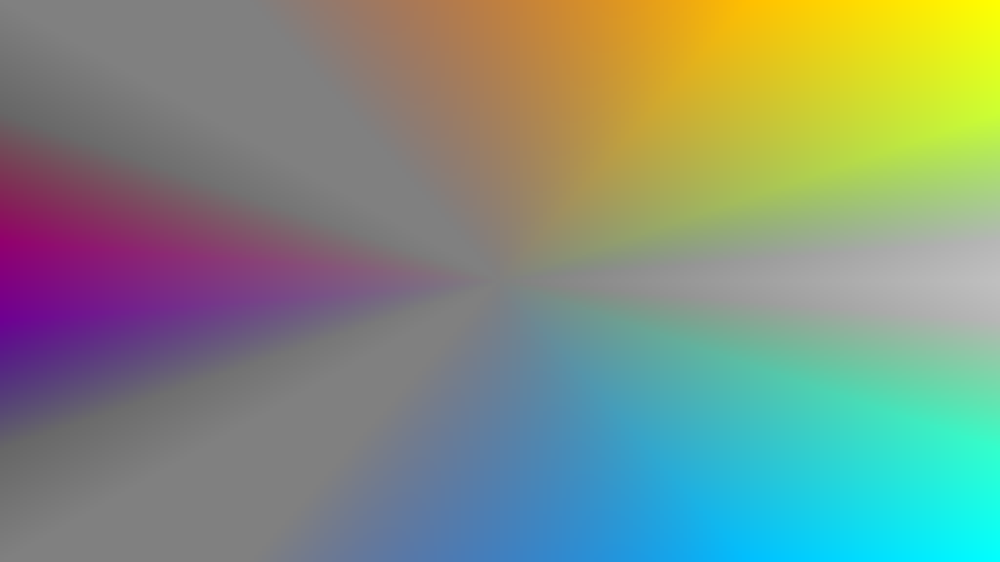
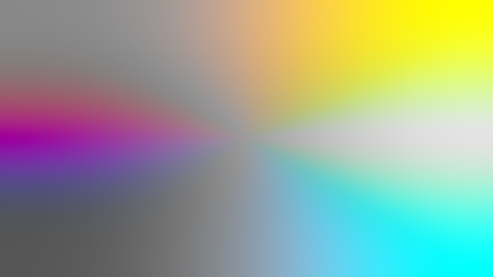
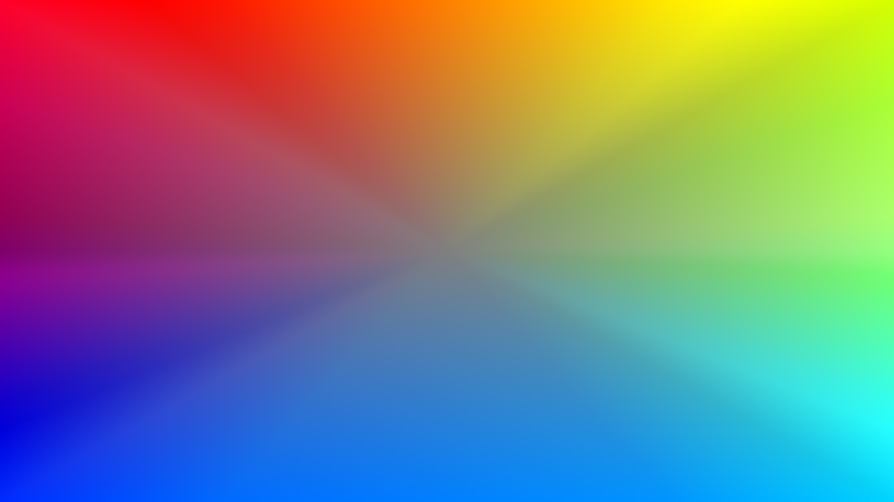
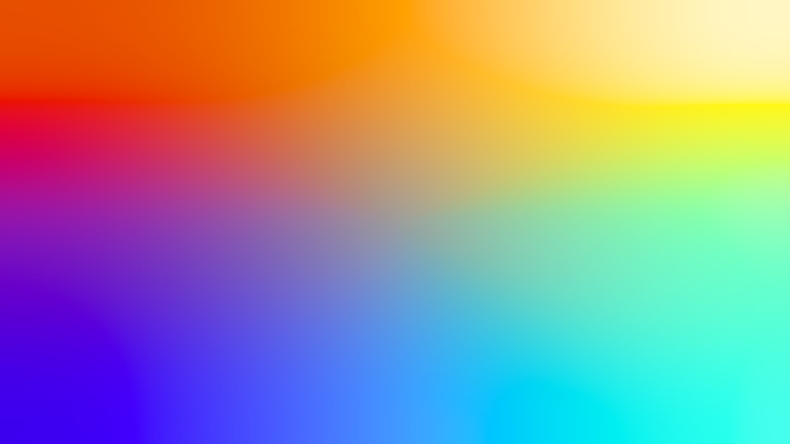
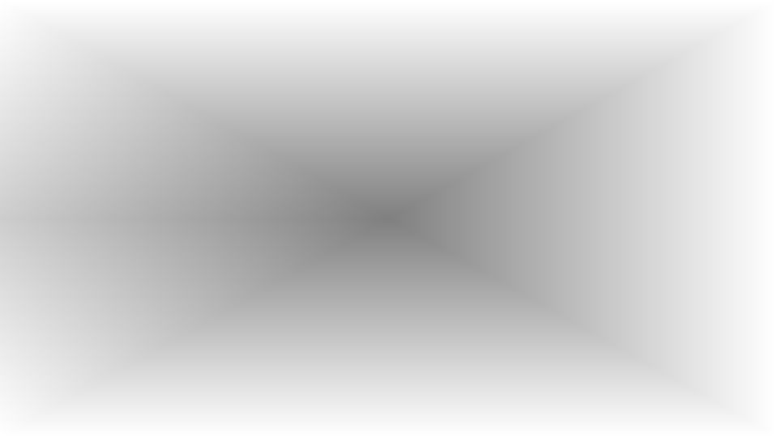

# Dark Melon

A SwiftUI image development app for RAW, SDR, and HDR images, with tone and color controls, GPU scopes, effects, and gain-map export.

## Download

**[Download Dark Melon for macOS](https://github.com/1096bimu/Dark-Melon/releases/latest)** — the current build requires **macOS 26 or later** and includes support for **Apple Silicon and Intel Macs**. **Intel is untested**. Unzip the download and drag Dark Melon into Applications. The app is Developer ID signed and notarized.

## HDR in formats people actually use

Export **JPEG or HEIF/HEIC with an HDR gain map**. Each file contains a finished SDR photograph plus extra highlight information for HDR viewers. JPEG gives recipients a familiar format that opens on most phones; HEIC fits naturally into Apple photo workflows.

You do not need an AVIF- or JPEG XL-specific workflow to see the photograph. Compatible viewers reveal the HDR rendition; other viewers show the SDR base. HDR still depends on the display and viewer, and sharing services may discard the gain map. Dark Melon writes ISO 21496-1 gain maps and also offers direct PQ HDR HEIF export.

## Sample image

**[Try the interactive SDR / HDR comparison →](https://1096bimu.github.io/Dark-Melon/)** — choose from five sample photographs, drag the divider, or toggle between renditions.

An original 2736 × 1824 JPEG export with an embedded ISO 21496-1 HDR gain map. Compatible viewers can show the HDR rendition; other viewers display the SDR base. Click the image to open the original file. HDR appearance depends on the browser, display, and system settings.

## Film emulation: the Kyoto collection

**[Room for chance: color variations →](https://1096bimu.github.io/Dark-Melon/variations/)** — ten HDR photographs and nine uncurated variations made with the Cross Process randomizer. Explore film-inspired color, then save and share a look.

**[Compare the authentic process →](https://1096bimu.github.io/Dark-Melon/authentic-process/)** — an aligned split viewer comparing halation and vignette with two alternatives. Zoom, pan, and inspect six details in the same photograph.

**[Explore the Kyoto photo essay →](https://1096bimu.github.io/Dark-Melon/film-emulation/)** — twelve photographs and a practical guide to Dark Melon’s film-inspired process: lens diffusion and vignette before grain and tone mapping, exposure-driven halation, Dye Response, and the two stages of white balance. Open any photograph for a full-size view.

## LUTs: use the camera maker’s own look

Dark Melon supports **3D `.cube` LUTs, including camera-log LUTs released by camera manufacturers themselves**. With an official LUT, you are applying the maker’s published color transform rather than a third-party attempt to recreate it. There is no need to guess whether a reproduction LUT faithfully matches the official transform: you can use the actual one.

The brightness information going into that LUT matters as much as the LUT itself. Dark Melon uses its **fully processed HDR rendition as the input to log LUTs**, retaining brightness relationships and highlight separation beyond SDR white. It then converts that image into the LUT’s intended log curve and gamut. This gives the manufacturer’s rendering the extended brightness range it was designed to work with, rather than feeding it an SDR image whose highlights have already been flattened or clipped.

The goal is a faithful application of the manufacturer’s branded color processing, with its own handling of color and bright highlights. The published LUT is authentic; an exact match to a particular camera still depends on exposure, sensor response, and RAW decoding.

### Example: Fujifilm’s official film-simulation LUTs

Download compatible `.cube` files from **[Fujifilm’s official LUT library](https://www.fujifilm-x.com/global/support/download/lut/)**. The example below applies Fujifilm’s **REALA ACE** LUT to a Sony RAW photograph, using **Fujifilm F-Log2 / Rec.2020** as input and **Rec.709 (BT.709)** as output.

1. In **Library**, use **Add → Add LUT…**. You can select multiple files at once; Dark Melon copies them into its own storage.
2. Right-click a LUT and choose **Configure LUT…**. Set its intended input and output gamma/gamut according to the LUT’s documentation. The window also shows its native grid size. Existing and packaged LUTs default to sRGB on both sides.
3. Select the LUT and **enable HDR Gain for log input**. Adjust HDR Gain to control the brightness entering the look. With HDR Gain off, a log-input LUT is bypassed without losing its selection.

Available profiles include **sRGB, Rec.709, Sony S-Log3 / S-Gamut3.Cine, Panasonic V-Log / V-Gamut, Canon C-Log3 / Cinema Gamut, Fujifilm F-Log / F-Gamut, and Fujifilm F-Log2 / Rec.2020**. Input and output can be configured separately.

**Log-input LUTs currently produce an SDR preview and export**, even though HDR is used to prepare their input. The LUT supplies the final SDR rendering; Dark Melon does not apply another tone curve afterward. Ordinary sRGB LUTs retain the existing SDR/HDR workflow.

## Features

- **RAW, SDR, and HDR image development**, with paired SDR/HDR previews and JPEG, HEIF, and TIFF export.
- **3D LUT support**, including official manufacturer log LUTs, per-LUT input/output profiles, and multi-file import. [See the Fujifilm example above.](#luts-use-the-camera-makers-own-look)
- **Batch export on macOS**, using saved settings or automatic development for unedited files, concurrent processing with a memory budget, and automatic filename-conflict handling.
- **Portable XMP sidecar settings**, leaving original images untouched. Unsaved recipes stay in a pending-edits list when switching images. Save commits them to sidecars; folder changes and normal close/quit ask before discarding pending work.
- **Copy and paste settings**, with separate choices for Tone, White Balance, Color, Effects, and RAW controls.
- **Folder-based file browser** with thumbnails, RAW/All filtering, Command/Shift selection, and outlines identifying images with saved edits.
- **White balance**, including averaged circular sampling, RGB gains, and RAW temperature/tint controls. Convert to WB transfers RGB adjustments into the RAW decoder where possible, preserving residual gains when its limits are reached.
- **Nondestructive crop, rotation, and perspective correction**, with a full-photo crop overview, conservative output-resolution estimate, and matching SDR/HDR export geometry.
- **Perceptual color controls** in OKLab: drag six color handles to adjust hue and chroma, with a Lightness slider for the selected color.
- **Chroma → Chroma and Lightness → Chroma graphs**, for controlling color intensity by existing chroma or brightness.
- **Gradient split toning**, with up to six tint nodes across shadows, midtones, and highlights.
- **Clarity** for local contrast, using a large-radius high-pass layer blended with Soft Light. Similar in purpose to Lightroom's Clarity, but a different implementation; negative strength softens contrast.
- **HDF filter** for soft glow, adding a blurred version of the image with adjustable strength and radius.
- **Film grain** based on cinegrain2, with adjustable size, strength, and tonal distribution—from a shadow-weighted response to a midtone peak—for convincing texture across different tones.
- **GPU histogram and vectorscope**, with both tone curves drawn over the source histogram.
- **sRGB, Display P3, and Rec.2020 processing**, plus RAW decoder controls where supported.

## Not yet included

Dark Melon is a focused image developer, not a full replacement for a commercial photo editor or library manager.

- No catalog or database; images stay in ordinary folders with optional sidecars.
- No ratings, flags, reject/keep workflow, or other culling tools.
- No file-management operations such as deleting, moving, or renaming source images.
- No updated thumbnails of edits in the file browser. Original files and their embedded previews remain untouched; the browser shows source thumbnails, while the main preview shows the developed result.
- No masks, brushes, gradients, subject selections, or other spatially selective edits. Color and tonal-range controls are global.

## Develop one photograph for SDR and HDR

Dark Melon uses a small set of coordinated controls to produce two useful renditions together. Start with an SDR image that looks properly exposed and toned. Then use HDR to reveal separation in bright windows, reflections, stage lights, and other highlights that SDR cannot fully show.

### A simple starting workflow

1. **Set white balance** so neutral surfaces and skin look right.
2. **Place Tone over the shade that matters most**, often a representative skin tone or midtone. While dragging, the gray overlay shows which pixels you are targeting.
3. **Adjust Contrast** for the desired separation and depth. The selected Tone region acts as your reference; negative contrast can soften an overly harsh image.
4. **Set the white point** to decide where the SDR rendition reaches white. Enable **Auto Tones** if you want help adjusting the tonal settings after releasing the Tone slider.
5. **Compare SDR and HDR.** Keep HDR Gain near its default for a restrained result. Add Rolloff to soften the brightest highlights, or turn HDR off for SDR-only output.
6. **Save the edit and export.** Sidecars keep your settings separate from the original; JPEG and HEIC gain maps carry both renditions in one file.

| Control | What to use it for |
| --- | --- |
| Black point | Choose where the deepest shadows become black. |
| White point | Choose which source brightness reaches white in SDR. Lower it to bring more of the image toward white. |
| Tone | Pick the source brightness around which you want to shape contrast. |
| Contrast | Add separation around Tone, or reduce contrast for a gentler rendering. |
| HDR Gain | Raise the brightness of the HDR rendition, or switch HDR off. |
| HDR Rolloff | Soften the HDR highlight shoulder instead of letting it continue straight upward. |

**Cyan is SDR; orange is HDR.** The white-point handle marks where SDR highlights reach white. The orange extension shows how HDR retains separation above that level. Neither version can restore detail that was already lost during capture.

If the app warns that HDR has become darker than SDR, a small increase in HDR Gain can resolve the crossing for gain-map export. Always check both previews: a pleasing HDR result should still have a useful SDR companion.

## An alternative to traditional HSL

Dark Melon's color controls are designed for **natural photographic adjustments with smooth transitions in perceived hue and brightness**. Use them to refine skin, calm strong greens, or bring neighboring colors closer together without introducing obvious bands between color ranges.

In the Color panel, drag a colored handle **inward or outward to change chroma**, or **around the graph to shift hue**. Select a handle to adjust its Lightness. The central ring represents zero chroma. Each color's influence fades smoothly toward its neighbors: adjusting red affects the range between magenta and yellow, leaving colors beyond those boundaries alone.

These controls use OKLab, a color space designed around perceived color differences. The practical benefit is smoother-looking transitions as colors change intensity or hue, helping processed photographs retain a natural appearance.

**This is a grading tool, not a color-replacement tool.** Hue movement is deliberately limited: a red car cannot be turned blue. Use small moves to refine the colors already present in the photograph.

### Test 1: red, green, and blue chroma set to zero

The “RGB removed” test sets the **red, green, and blue color controls to zero saturation/chroma**, leaving the other three controls unchanged. It does **not** remove the image's RGB channels.

Compare the transitions into gray and the brightness of the remaining colors. In these samples, Dark Melon retains smoother transitions; the traditional HSL result shows more pronounced wedges and brightness changes around the desaturated ranges.

| Traditional HSL | Dark Melon |
| --- | --- |
|  |  |

### Test 2: alternating hue shifts

The “alternate” test shifts successive color controls by **alternating +10° and −10°**. Neighboring colors move in opposing directions, making uneven transitions easier to see.

Dark Melon's result shows smoother perceived hue and brightness transitions, while the traditional result develops more distinct bands between some neighboring colors. This is the behavior we want when making modest color changes in a photograph: gradual variation should continue to look gradual.

| Traditional HSL | Dark Melon |
| --- | --- |
|  |  |

### From color to natural black and white

The same controls extend to monochrome: **set all six color handles to zero chroma** to remove color while retaining OKLab lightness. This gives a starting point that respects the perceived brightness differences in the color image, with smooth transitions between the resulting gray tones.

The B&W test below compares the supplied black-and-white filter result with Dark Melon. Notice the filter result's bright outer regions and central dark shape, while Dark Melon keeps a gradual progression of light and dark across the gradient. The difference is not simply how much color disappears, but which brightness relationships remain afterward.

| B&W filter | Dark Melon |
| --- | --- |
|  |  |

For a color photograph, start with all six chroma controls at zero, then select individual handles and adjust **Lightness** to refine how their original colors appear in monochrome. For example, lighten skin-related hues or deepen blue skies while retaining gradual transitions into neighboring tones. Leave Split Tone neutral for pure black and white, or add a subtle tint as a finishing step.

Click any comparison image to view it larger. Color gradient samples are 1280 × 720 PNGs; the B&W samples retain their supplied 960 × 540 resolution. All are SDR, sRGB images. These comparisons illustrate the supplied examples, rather than every possible HSL or black-and-white implementation.

### Finish the color grade

The Color panel follows the processing order:

1. **Chroma graphs:** tame already-vivid colors, enrich quieter ones, or adjust color intensity separately in shadows and highlights.
2. **Per-color graph:** refine individual hue ranges and their lightness.
3. **Split tone:** add a finishing tint with nodes along the lightness gradient. A single node tints the whole range; additional nodes let shadows, midtones, and highlights take on different colors. Move a node's strength toward the center for less tint.

## Effects: texture, glow, and emphasis

- **Clarity:** bring out local texture, or use a negative amount for a softer look. Radius controls the scale of the detail being emphasized.
- **HDF:** add a broad, soft glow. Start with a small amount to retain structure while softening the overall impression.
- **Halation:** add a warm halo around bright areas when HDR is enabled. Radius changes its reach; Transmission changes how much green joins the red glow.
- **Film Grain:** add texture with controls for size, strength, and distribution. Shift the distribution toward shadows or midtones to decide where the grain is most visible.
- **Vignette:** darken the corners of the committed crop. Amount controls the darkening; Spread brings the effect farther toward the center.

Use the panel's hold-to-Compare button to judge whether the effect improves the photograph. Start gently, then check both SDR and HDR before exporting.

For implementation and recipe details, see [DevelopmentSettings.md](DevelopmentSettings.md).

## Open the project

Open `Dark Melon.xcodeproj` in Xcode, select the **Dark Melon** scheme and your destination, then run. This project currently targets macOS, iOS, and visionOS 27. Device builds may require selecting your own signing team.

Development edits are stored in XMP sidecars; see [DevelopmentSettings.md](DevelopmentSettings.md). Batch export is available on macOS.

## Third-party code

The film grain implementation is adapted from [cinegrain2](https://github.com/mr-berndt/cinegrain2). Its attribution is in `FilmGrain.swift`, and its GPL-3.0-or-later license is included in `Dark Melon/Cinegrain2-LICENSE.txt`.

## License

Dark Melon source code is licensed under the **GNU General Public License version 3 (GPL-3.0-only)**. Copyright © 2026 Dark Melon contributors. See [LICENSE](LICENSE) for the full terms. This software is distributed without warranty.

The film grain implementation is adapted from [cinegrain2](https://github.com/mr-berndt/cinegrain2), copyright © 2026 mr-berndt, licensed under **GPL-3.0-or-later**. Its original attribution and bundled license are retained. Dark Melon's adaptation adds image-processing integration and adjustable grain controls.
