# Dark Melon

A RAW, SDR, and HDR image developer with a film-inspired process, direct color controls, and nondestructive edits.

## Download

**[Download Dark Melon for macOS](https://github.com/1096bimu/Dark-Melon/releases/latest)**

Requires **macOS 26 or later**. Universal app for **Apple Silicon and Intel Macs; Intel is untested**. Unzip the download and drag Dark Melon into Applications. The app is Developer ID signed and notarized.

## Accessible HDR

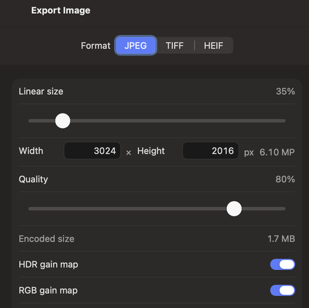

Export a familiar JPEG with an ISO 21496-1 HDR gain map. SDR viewers show your explicitly authored SDR look and white point; compatible HDR viewers reveal the extra highlight range. HDR display depends on the viewer and screen.

[Explore the SDR / HDR comparison →](https://1096bimu.github.io/Dark-Melon/)

## The full exposure, in view

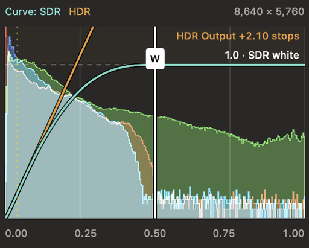

See the source histogram together with the complete SDR and HDR tone curves. Decide what reaches SDR white and how much brightness extends into HDR headroom, without guessing what lies beyond the histogram.

## Dust correction without cloning

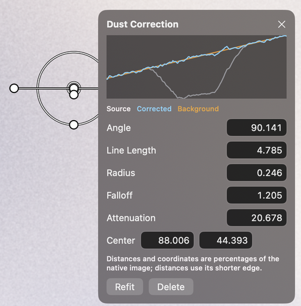

Counteract a dust spot’s shadow with a localized exposure correction. Restore the underlying image with minimal change, without copying texture from somewhere else.

## Use the camera maker’s LUT

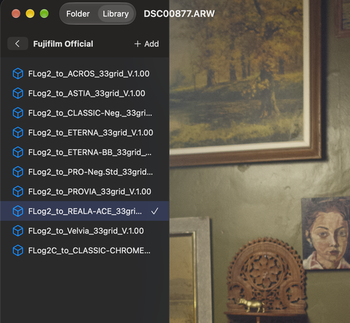

Use 3D `.cube` LUTs, including cinematography-focused log LUTs published by camera manufacturers. Configure the intended input and output gamma/gamut; Dark Melon prepares log input from its processed HDR image. Log-input LUTs produce SDR output.

## Double exposure as an edit

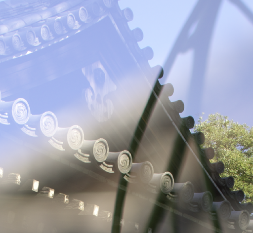

Combine photographs nondestructively as part of the edit. Keep the source files and editable settings, without creating a duplicated photograph or a large rendered RGB intermediate.

## Texture shaped by light

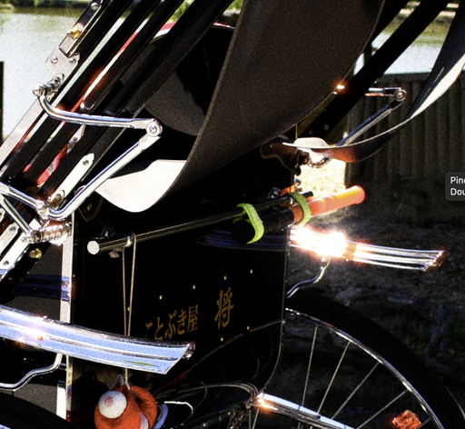

Halation, grain, diffusion, and vignette follow a film-inspired process. HDR exposure information drives the glow even in the SDR rendition, distinguishing intense light sources from surfaces that merely render white.

[Compare the authentic process →](https://1096bimu.github.io/Dark-Melon/authentic-process/) · [Explore the Kyoto photo essay →](https://1096bimu.github.io/Dark-Melon/film-emulation/)

## Reference windows for extra monitors

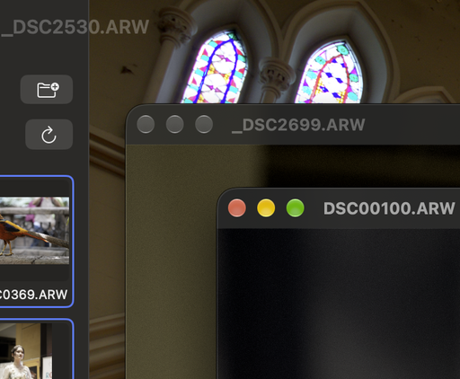

Open additional reference windows to keep photographs in view across multiple displays while you work.

## Compare photographs and edits

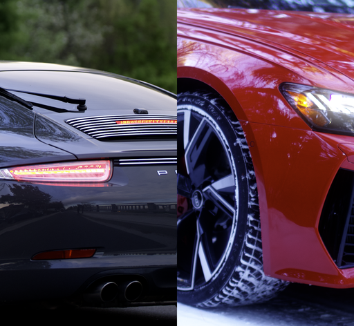

Compare different files or different states of the same photograph using snapshots. Keep comparisons together in the editor or use a reference window on another monitor.

## See and bend your colors

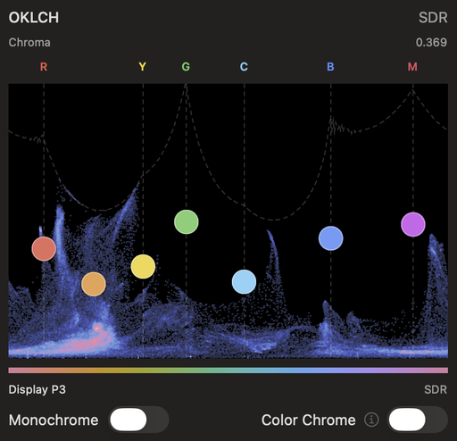

The Mountain Range graph shows where colors sit and how close they are to the working gamut’s limits. Drag the color handles directly to shape the colors you see.

## Film-like color, ready to explore

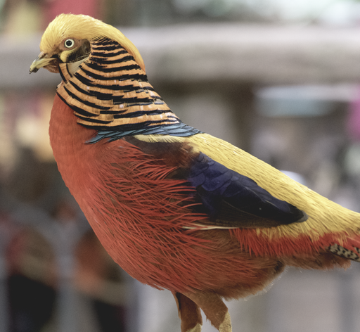

Simulated dye sensitivity and spectral-response mismatch create film-inspired color variations. Adjust the process or randomize a look—from subtle shifts to the plausible surprises of cross-processing and expired film. Save a favorite as a preset or share it through a short code.

[Room for chance: explore the color variations →](https://1096bimu.github.io/Dark-Melon/variations/)

## Apple RAW development

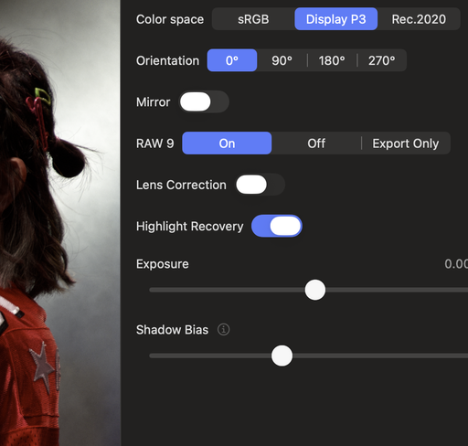

Develop supported RAW files with Apple’s RAW decoder and controls for exposure, white balance, noise reduction, and detail. RAW 9 is available on supported hardware and operating systems.

## Clarity at the scale you choose

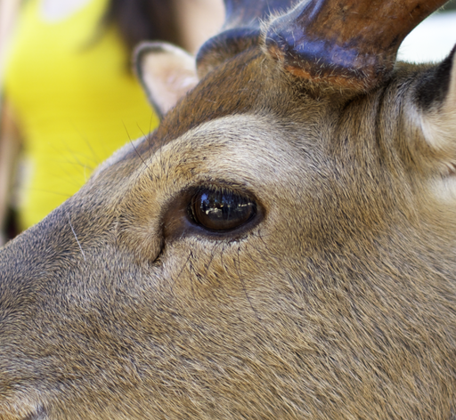

Bring out local contrast or soften the image. Adjust the radius to choose the scale of the detail being emphasized.

## Perspective, rotation, and crop

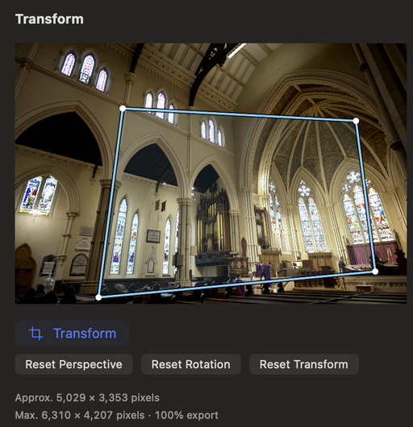

Straighten lines, adjust perspective, rotate, and crop nondestructively. Keep the framing consistent between your SDR and HDR renditions.

## Presets and snapshots

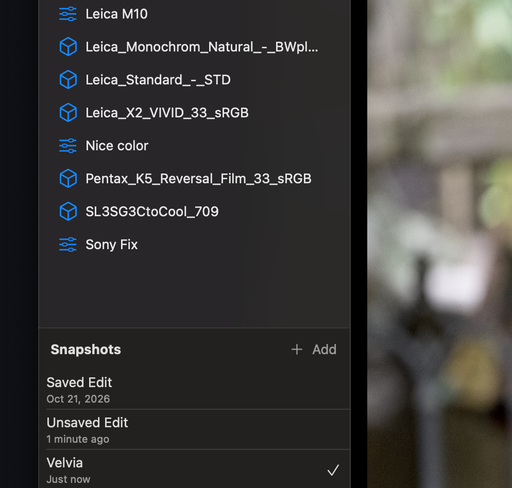

Reuse a look across photographs with presets, and save different versions of a single edit as snapshots. Development settings live beside your originals in XMP sidecars.

## Build and development

Open `Dark Melon.xcodeproj` in Xcode and select the **Dark Melon** scheme. For processing controls and recipe details, see [DevelopmentSettings.md](DevelopmentSettings.md).

## License

Dark Melon source code is licensed under the **GNU General Public License version 3 (GPL-3.0-only)**. Copyright © 2026 Dark Melon contributors. See [LICENSE](LICENSE) for the full terms. This software is distributed without warranty.
